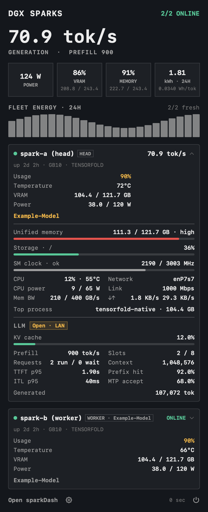

<p align="center">
  
</p>

[](https://github.com/amer8/pulsebar/actions/workflows/quality.yml)

## sparkDash fleet mode (this fork)

This fork reads [sparkDash](https://github.com/MiaAI-Lab/sparkDash) instead of the per-unit DGX Dashboard, with a panel modelled on
[omarchy-sparkdash](https://github.com/patcastle/omarchy-sparkdash):

- Menu bar: hosts online, total generation tok/s (GPU usage when idle) and the hottest GPU temperature. The icon changes when a
  host is unreachable, throttled, low on storage or its LLM is down.
- Panel: fleet tok/s and prefill, power, VRAM, unified memory, 24 h energy with an hourly chart, exceptions, and one card per
  host with a 30-minute tok/s sparkline. Click a card for memory, storage, SM clock, CPU, network, top process and LLM engine
  detail (KV cache, slots, requests, TTFT/ITL p95, prefix-cache hit rate, MTP acceptance).
- It polls `/api/sparks`, `/api/sparks/:id/metrics` and `/api/fleet-energy` every 3 s.

<p align="center"></p>

Connection (gear button in the panel, or `defaults write dev.pulsebar.PulseBar.sparkdash <key> <value>`):

- `SparkDash.URL`: sparkDash base URL, default `http://127.0.0.1:5555`.
- `SparkDash.SSHHost`: optional SSH host (e.g. `spark-head`). When set, PulseBar keeps its own
  `ssh -N -L <free port>:127.0.0.1:<URL port>` tunnel to that host (key auth, `BatchMode`) and reads sparkDash through it,
  so a dashboard bound to loopback on the Spark needs no exposure. Only that ssh process is stopped on quit.

Build and install: `make install` (to `~/Applications/PulseBar.app`, bundle id `dev.pulsebar.PulseBar.sparkdash`).
Render the panel to a PNG without the menu bar: `PulseBar --render-panel out.png [--demo] [--expand]`.

`PulseBar` is an unofficial macOS menu bar monitor for telemetry exposed by the DGX Dashboard web app on NVIDIA DGX Spark and compatible NVIDIA GB10-based OEM systems. It signs in to the local dashboard, listens to the server-sent event stream, and shows a compact `RAM` and `GPU` status item in the menu bar.

## Requirements

- macOS 13 Ventura or newer.
- Local DGX Dashboard reachable at `http://127.0.0.1:11000` through either NVIDIA Sync or a manual SSH tunnel.
- Valid dashboard credentials.

## Compatible Systems

PulseBar targets the local DGX Dashboard rather than a specific enclosure. Known compatible NVIDIA GB10 variants are:

- [NVIDIA DGX Spark](https://www.nvidia.com/en-us/products/workstations/dgx-spark/)
- [Acer Veriton GN100 AI Mini Workstation](https://www.acer.com/us-en/desktops-and-all-in-ones/veriton-workstations/veriton-gn100-ai-mini-workstation)
- [ASUS Ascent GX10](https://www.asus.com/de/networking-iot-servers/desktop-ai-supercomputer/ultra-small-ai-supercomputers/asus-ascent-gx10/)
- [Dell Pro Max with GB10](https://www.dell.com/de-de/dt/lp/dell-pro-max-nvidia-ai-dev)
- [GIGABYTE AI TOP ATOM](https://www.gigabyte.com/de/AI-TOP-PC/GIGABYTE-AI-TOP-ATOM)
- [HP ZGX Nano AI Station](https://www.hp.com/de-de/workstations/zgx-nano-ai-station.html)
- [Lenovo ThinkStation PGX](https://www.lenovo.com/de/de/p/workstations/thinkstationp/lenovo-thinkstation-pgx-sff/len102s0023)
- [MSI EdgeXpert MS-C931](https://ipc.msi.com/product_detail/Industrial-Computer-Box-PC/AI-Supercomputer/EdgeXpert-MS-C931)

[NVIDIA Sync](https://build.nvidia.com/spark/connect-to-your-spark/sync) can expose the local dashboard automatically. Without NVIDIA Sync, forward the dashboard port manually, following NVIDIA's [manual SSH flow](https://build.nvidia.com/spark/connect-to-your-spark/manual-ssh):

```bash
ssh -L 11000:localhost:11000 <username>@<IP-or-spark-hostname.local>
```

Then open `http://127.0.0.1:11000` and sign in with the same dashboard credentials PulseBar uses.

## Installation

Install the Homebrew cask from the [amer8 Homebrew Tap](https://github.com/amer8/homebrew-tap):

```bash
brew install --cask amer8/tap/pulsebar
```

Alternatively, download the latest [GitHub Release](https://github.com/amer8/pulsebar/releases) DMG file, open it, and drag `PulseBar.app` to Applications.

Signed direct-download builds can check for app updates from the PulseBar menu.

Click the info button (ⓘ) in the telemetry panel header to see the app version, build,
release date, and project links.

## First Run

1. Launch PulseBar.
2. Open `Preferences…` from the menu bar item.
3. Enter your dashboard username and password.
4. After sign-in, PulseBar stores the returned token in Keychain and starts the telemetry stream.
5. On later launches, PulseBar restores the saved session and reconnects automatically.

## Development

See [CONTRIBUTING.md](CONTRIBUTING.md) for source setup, local builds, the release process, and implementation details.

## License

PulseBar is released under the MIT License. See `LICENSE`.

## Legal Notice

PulseBar is an independent, unofficial project and is not affiliated with, sponsored by, endorsed by, or approved by NVIDIA Corporation. NVIDIA, NVIDIA Sync, DGX, DGX Spark, GB10, and DGX Dashboard are trademarks, registered trademarks, or product names of NVIDIA Corporation or its affiliates. Other company and product names are trademarks, registered trademarks, or product names of their respective owners. Their use here is solely to identify compatibility with a locally running dashboard and supported hardware.

## Privacy And Security

See [SECURITY.md](SECURITY.md) for privacy and security details.
